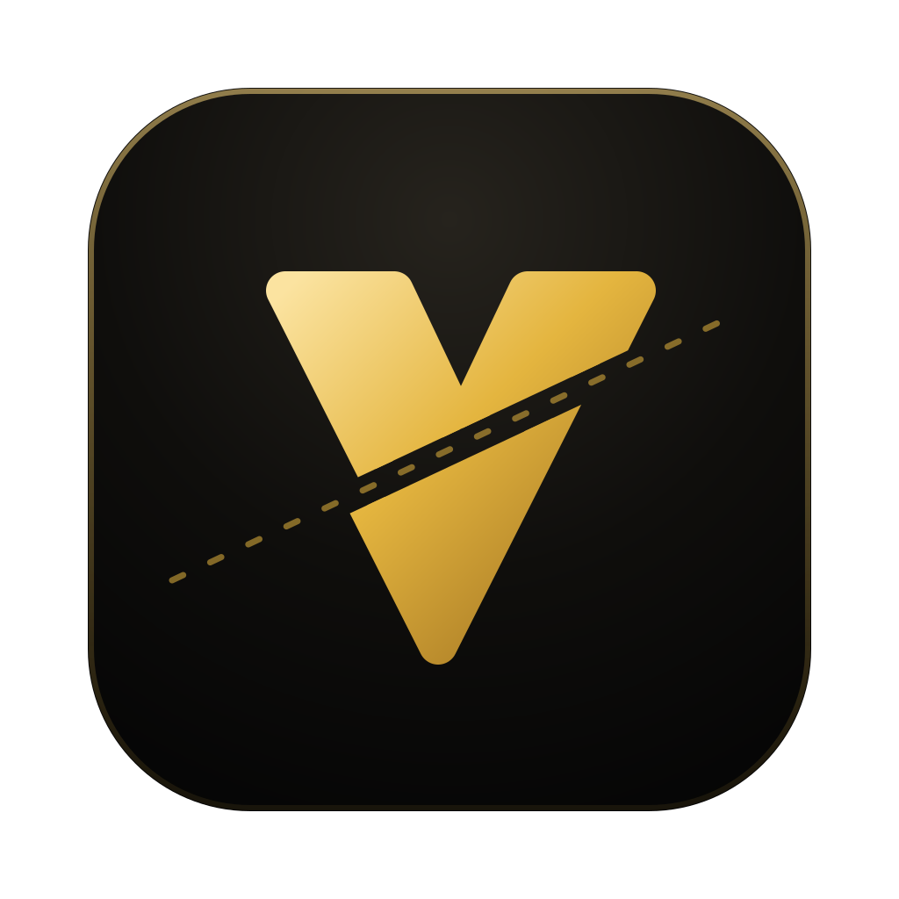
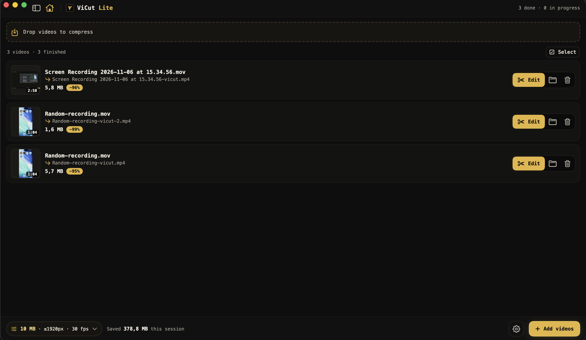
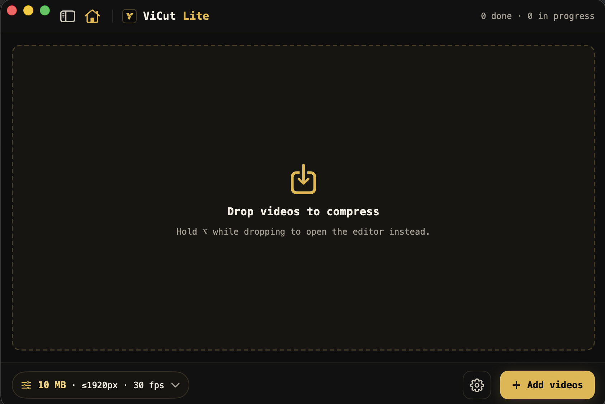

<p align="center">
  
</p>

<h1 align="center">ViCut Lite</h1>

<p align="center">
  <b>Turn heavy screen recordings into GitHub-ready MP4s, and cut the boring parts on the way.</b><br>
  A tiny, free and open source macOS app.
</p>

<p align="center">
  <a href="https://github.com/nhanta0408/vicut-lite/releases/latest"></a>
  <a href="LICENSE"></a>
  
  
</p>

## Install

1. Download **`ViCut-Lite-x.y.z.dmg`** from the [latest release](https://github.com/nhanta0408/vicut-lite/releases/latest).
2. Open it and drag **ViCut Lite** into **Applications**.
3. Allow the first launch. The app isn't notarized by Apple yet, so macOS blocks it once. Pick one:

   **Terminal (fastest, any macOS version):**

   ```bash
   xattr -dr com.apple.quarantine "/Applications/ViCut Lite.app"
   ```

   **System Settings:** open ViCut Lite once and dismiss the warning, then go to
   **System Settings → Privacy & Security**, scroll down and click **Open Anyway**.
   On macOS 14 you can also right-click the app → **Open** → **Open**.

Requires macOS 14+ on Apple Silicon.

## Why

A 2-minute screen recording is often 200 MB+, and GitHub only takes 10 MB attachments on free plans.
ViCut Lite squeezes it under the limit in seconds, keeps text readable, and lets you cut or speed up the parts
nobody wants to watch.

<p align="center">
  
</p>

<table>
  <tr>
    <td width="50%"></td>
    <td width="50%" valign="middle">
      <b>One drop zone.</b> Drop to compress, hold <kbd>⌥</kbd> to open the editor.<br><br>
      <b>One glance.</b> Size, saving and output name per video, plus what the whole session saved.
    </td>
  </tr>
</table>

## Quick start

| Do this | You get |
|---|---|
| Drop videos on the window | `name-vicut.mp4` next to each original, ≤ 10 MB |
| Hold <kbd>⌥</kbd> while dropping, or click **Edit** | The editor: mark parts as **Cut**, **2×** or **4×**, then **Export** (⌘E) |
| Drag a finished row into GitHub, Slack or Mail | The compressed file, attached |
| Sidebar → **Settings** | Target size, resolution, fps, audio, **Fast / Light** encoder |

Editor keys: <kbd>Space</kbd> play · drag to select · <kbd>C</kbd> cut · <kbd>2</kbd> / <kbd>4</kbd> speed up ·
<kbd>K</kbd> back to normal · <kbd>⌘Z</kbd> undo · <kbd>⌘E</kbd> export.

## Build from source

```bash
git clone https://github.com/nhanta0408/vicut-lite.git && cd vicut-lite
./scripts/build-app.sh   # → dist/ViCut Lite.app  (Xcode 16+, macOS 14+, Apple Silicon)
```

Issues and pull requests are welcome. Branch from `develop` and keep `swift test` green.

## License

Free software under the [GNU GPL v3](LICENSE). Release builds bundle unmodified [FFmpeg](https://ffmpeg.org) 9.0.2
(GPLv3); source and notices are in [THIRD_PARTY_NOTICES.md](THIRD_PARTY_NOTICES.md).

<p align="center"><sub>Made by Nhan Ta (Brian)</sub></p>
