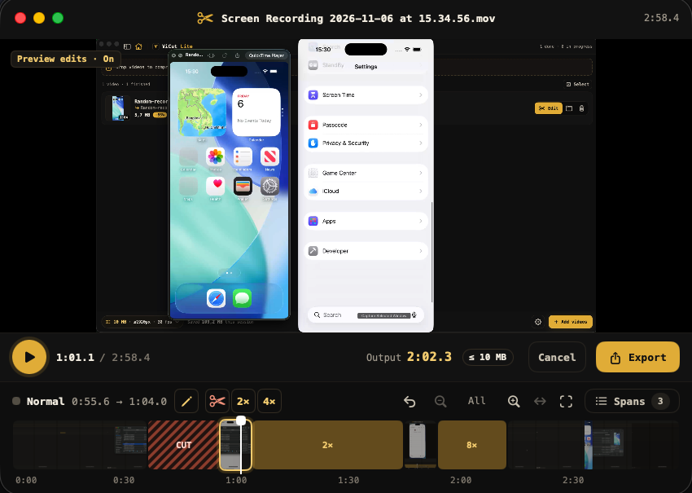
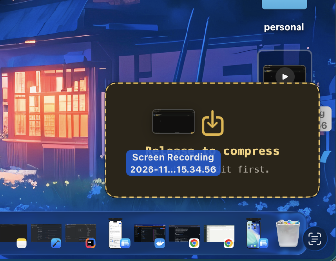
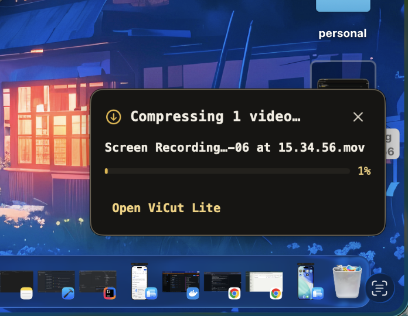
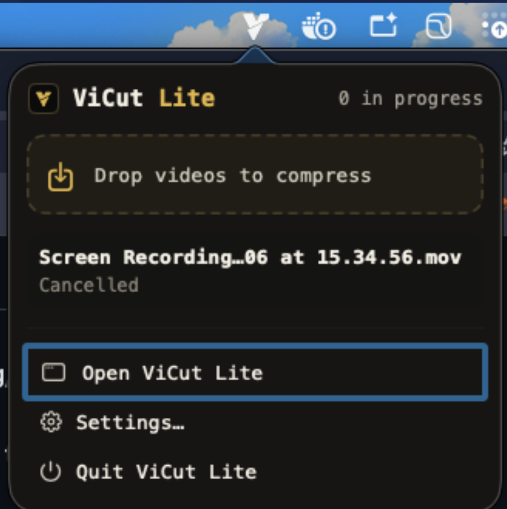
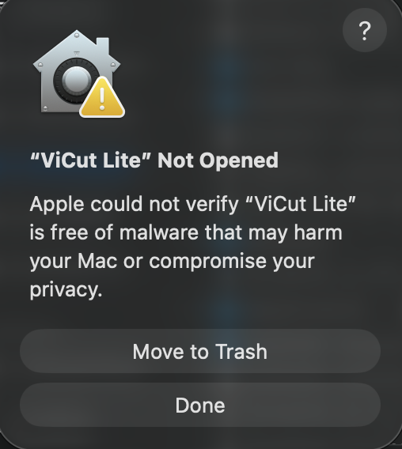

<p align="center">
  
</p>

<h1 align="center">ViCut Lite</h1>

<p align="center">
  <b>Turn heavy screen recordings into GitHub-ready MP4s, and cut the boring parts on the way.</b><br>
  A tiny, free and open source macOS app.
</p>

<p align="center">
  <a href="https://github.com/nhanta0408/vicut-lite/releases/latest"></a>
  <a href="LICENSE"></a>
  
  
</p>

## Install

1. Download **`ViCut-Lite-x.y.z.dmg`** from the [latest release](https://github.com/nhanta0408/vicut-lite/releases/latest).
2. Open it and drag **ViCut Lite** into **Applications**.
3. Open **ViCut Lite**. The first time, macOS asks you to confirm an app from outside the App Store:
   it takes one click, see [First launch on macOS](#first-launch-on-macos).

Requires macOS 14+ on Apple Silicon.

## Why

A 2-minute screen recording is often 200 MB+, and GitHub only takes 10 MB attachments on free plans.
ViCut Lite squeezes it under the limit in seconds, keeps text readable, and lets you cut or speed up the parts
nobody wants to watch.

<table>
  <tr><th>Quick Compress</th></tr>
  <tr><td align="center"></td></tr>
</table>

<table>
  <tr><th>Simple Edit with Cut, Speed-up</th></tr>
  <tr><td align="center"></td></tr>
</table>

### Also in the box

<table>
  <tr>
    <th width="25%">Drop zone while dragging</th>
    <th width="25%">Working progress card</th>
    <th width="25%">Live in the menu bar</th>
    <th width="25%">One drop zone</th>
  </tr>
  <tr>
    <td align="center" valign="top"></td>
    <td align="center" valign="top"></td>
    <td align="center" valign="top"></td>
    <td align="center" valign="top"></td>
  </tr>
</table>

## Quick start

| Do this | You get |
|---|---|
| Drop videos on the window | `name-vicut.mp4` next to each original, ≤ 10 MB |
| Hold <kbd>⌥</kbd> while dropping, or click **Edit** | The editor: mark parts as **Cut**, **2×** or **4×**, then **Export** (⌘E) |
| Drag a finished row into GitHub, Slack or Mail | The compressed file, attached |
| Start dragging a video anywhere, or drop it on the menu bar icon | A drop zone pops up in the screen corner: drop to compress (<kbd>⌥</kbd> to edit). Hide the Dock icon in **Settings → Menu bar** |
| Sidebar → **Settings** | Target size, **Smaller / Balanced / Sharper** quality, resolution, fps, audio, **Fast / Light** encoder |

Editor keys: <kbd>Space</kbd> play · drag to select · <kbd>C</kbd> cut · <kbd>2</kbd> / <kbd>4</kbd> speed up ·
<kbd>K</kbd> back to normal · <kbd>⌘Z</kbd> undo · <kbd>⌘E</kbd> export.

## Build from source

```bash
git clone https://github.com/nhanta0408/vicut-lite.git && cd vicut-lite
./scripts/build-app.sh   # → dist/ViCut Lite.app  (Xcode 16+, macOS 14+, Apple Silicon)
```

Issues and pull requests are welcome; see [CONTRIBUTING.md](CONTRIBUTING.md).

## License

Free software under the [GNU GPL v3](LICENSE). Release builds bundle unmodified [FFmpeg](https://ffmpeg.org) 9.0.2
(GPLv3); source and notices are in [THIRD_PARTY_NOTICES.md](THIRD_PARTY_NOTICES.md).

## FAQ

### First launch on macOS

ViCut Lite is free and open source, but it isn't notarized by Apple yet (that needs a paid Apple Developer
account). So the first time you open it, macOS shows this:

<p align="center">
  
</p>

Click **Done** (not *Move to Trash*), then allow it once in either way:

- **System Settings:** go to **System Settings → Privacy & Security**, scroll down and click **Open Anyway**
  next to the ViCut Lite message. On macOS 14 you can also right-click the app → **Open** → **Open**.
- **Terminal:**

  ```bash
  xattr -dr com.apple.quarantine "/Applications/ViCut Lite.app"
  ```

After that it opens normally. You can check what you're running: the whole source is in this repo, and each
release lists the SHA-256 of its `.dmg`.

<p align="center"><sub>Made by Nhan Ta (Brian)</sub></p>
